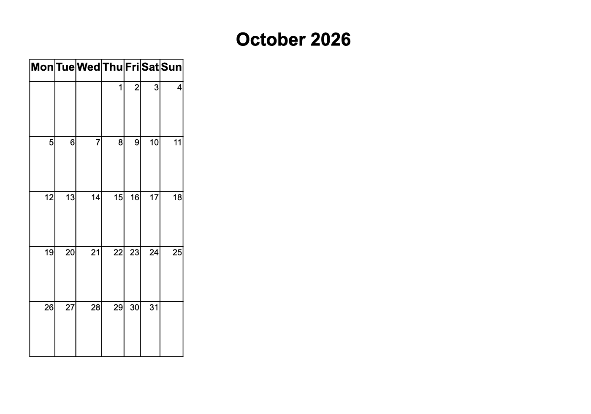

# word-calendar-generator

A simple calendar generator for Word or WordCraft; I always wanted a simple
calendar generator, after tinkering with msword I just went to opencode and
asked the AI to generate me one and that was even faster than tinkering.

One page per month: month title, Mon-Sun header row and a bordered grid with
tall cells to write in. The table always scales to fit exactly one page.



## Install

Requires [uv](https://docs.astral.sh/uv/) and Python 3.14+.

```bash
git clone https://github.com/dnvriend/word-calendar-generator.git
cd word-calendar-generator
uv tool install .
```

## Usage

```bash
word-calendar-generator generate 10 2026                        # October 2026, landscape
word-calendar-generator generate 10 2026 4                      # Oct 2026 - Jan 2027
word-calendar-generator generate 10 2026 1 --orientation portrait
word-calendar-generator generate 10 2026 4 --output-dir ~/Documents
```

Writes `calendar-<year>-<month>.docx` to `~/Downloads` (or `--output-dir`).

## Arguments

| Argument       | Description                                             | Default     |
| -------------- | ------------------------------------------------------- | ----------- |
| `MONTH`        | Month number 1-12                                       | required    |
| `YEAR`         | Full year, e.g. 2026                                    | required    |
| `MONTHS`       | Consecutive months, one page each                       | 1           |
| `--orientation`| `landscape` or `portrait` (A4)                          | landscape   |
| `--output-dir` | Destination directory                                   | ~/Downloads |

## Development

`make pipeline` (full gate) or `make check` (light gate).

## Backlog

- Start-of-week option (currently Monday only)
